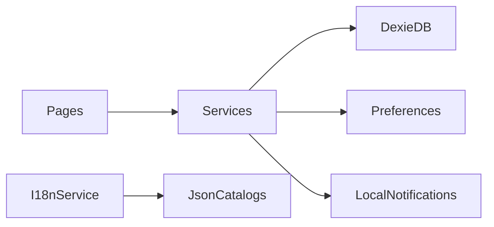

# Architecture

OK! Note is a local-first Ionic Angular app. UI pages talk to injectable services; services own persistence and native plugins. There is no backend.

## High-level flow

## Routing

- Shell: Ionic tabs (`src/app/tabs/`).
- Notes list and settings as tab roots.
- Note editor routes: `notes/new` and `notes/:id` (lazy-loaded standalone pages).

## Services

| Service | Responsibility |
|---------|----------------|
| `NoteService` | CRUD, search, Zod validation, reminder sync |
| `NoteDatabase` / `noteDb` | Dexie IndexedDB (`ok-note` database) |
| `ThemeService` | Light/dark palette via Capacitor Preferences |
| `I18nService` | Locale catalogs and `document.documentElement.lang` |
| `NotificationService` | Local notifications on native; web-safe stubs |
| `AlertService` | Centralized alerts and toasts |

Native Capacitor APIs are used only inside services so pages stay platform-agnostic.

## Data

- **Notes**: IndexedDB via Dexie (`src/app/services/note-db.ts`). Schema and types live in Zod (`src/app/models/note.schema.ts`).
- **Preferences**: Capacitor Preferences with keys from `src/app/constants/storage-keys.ts` (`ok-note.theme`, `ok-note.locale`).

## i18n and theme

- Custom i18n: JSON catalogs under `src/assets/i18n/` and a `translate` pipe (not ngx-translate / Angular i18n).
- Theme: explicit light/dark toggle using Ionic’s `ion-palette-dark` class on `<html>` (no automatic system sync).

## Notifications

On native platforms, reminders use Capacitor Local Notifications. On web (and in e2e), the service returns a pseudo notification id so reminder state remains testable without a native runtime.

## Testing

- **E2E**: Playwright (`e2e/`, `playwright.config.ts`) — primary coverage of user flows; IndexedDB reset per test.
- **Unit**: Vitest through the Angular unit-test builder (`npm test`).

See also the [ADR index](adr/README.md).
